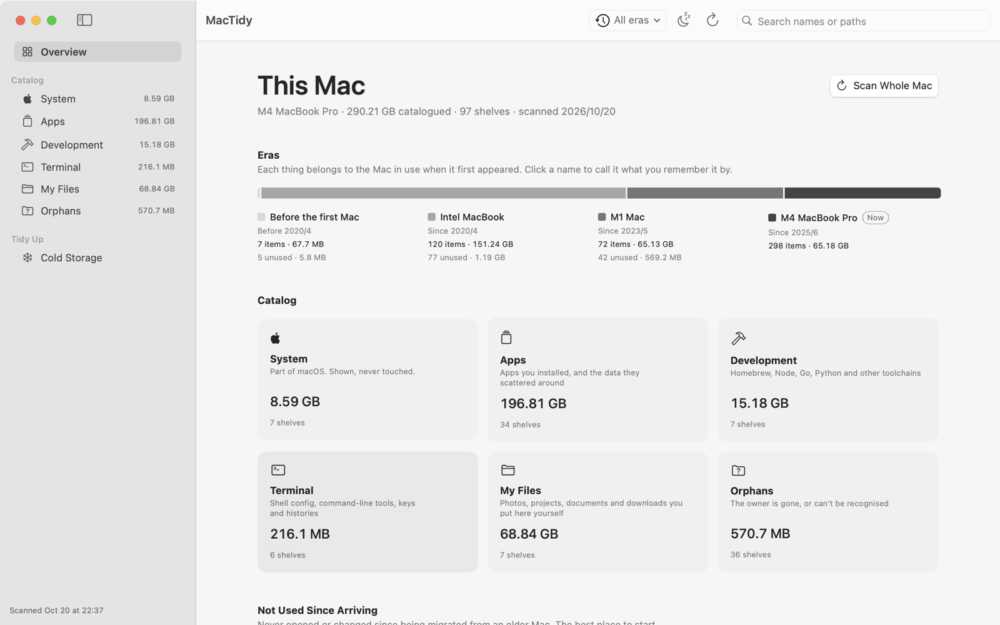
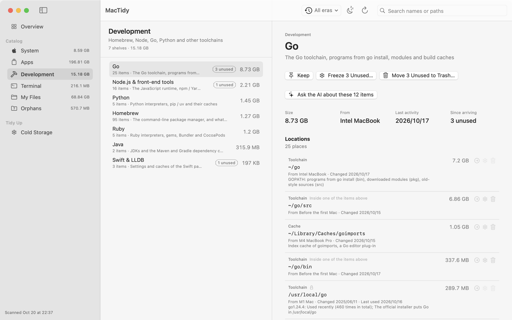
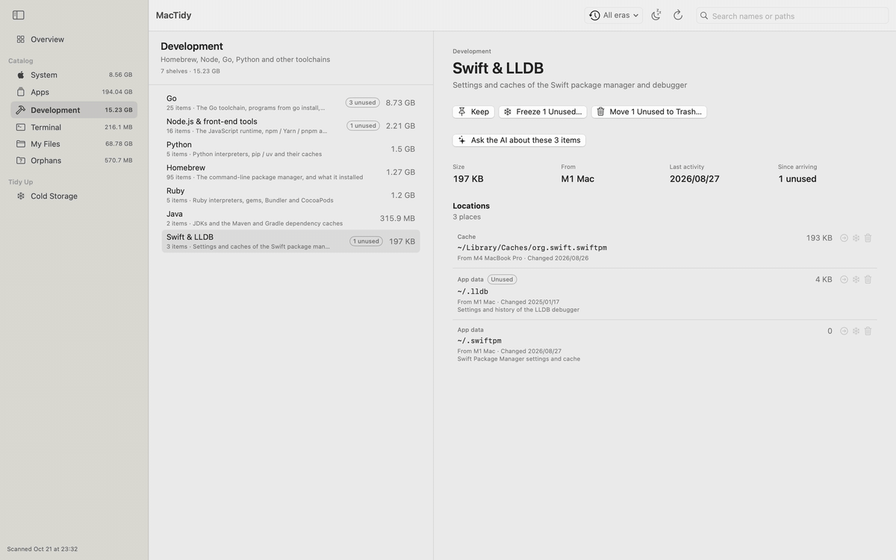

# MacTidy

[English](README.md) · **简体中文**

给一台搬过好几次家的 Mac 做一次只读的「考古编目」。

**[下载最新版本](https://github.com/chrions/MacTidy/releases/latest)** · macOS 14 以上 · Apple 芯片 · 免费开源

迁移助理会把所有东西原样搬过来：三台 Mac 之前就不用的应用、它们留下的数据、旧的 Intel 工具链、已卸载软件的开机服务、散落在个人文件夹里的密钥和历史记录。MacTidy 像图书管理员一样把这些东西清点一遍，并回答三个问题：

- **它是谁的？** 属于哪个应用、工具或系统功能，或者主人已经不在了。
- **它是从哪台 Mac 来的？** 每台迁移过的 Mac 都会在 `~/Library/Keychains` 里留下一个文件夹。MacTidy 按它们的创建时间划分「年代」，每样东西归到它最早那个文件所在的年代。
- **搬来之后用过吗？** 根据 Spotlight 的最近打开时间、数据文件夹的修改时间和命令历史判断。

拿不准的东西可以先挪进**冷藏区**，原来的位置都记着，一键就能放回。







## 功能

- **按类别分书架**：系统、应用、开发环境（Homebrew、Node、Go、Python、Ruby、Java、Rust 等）、终端与命令（Shell 配置、命令行工具、密钥、历史记录）、我的文件、无主之物。
- **根据迁移痕迹推断年代**，每个年代都可以改成你记得的名字，比如「公司那台 Intel MacBook」。
- **「搬来后没用过」筛选**，专门看迁移过来以后就再没碰过的东西。
- **保留、冷藏、移到废纸篓**，可以对单项操作，也可以对整个书架。冷藏会把东西挪到 `~/MacTidy Cold Storage` 并记下清单；废纸篓清倒之前，扔掉的东西都能放回。
- **内置知识库**，认得常见应用、SDK 残留、点文件和各种版本管理器（nvm、pyenv、rbenv、n、旧的 Intel Homebrew 等）。
- **可选的 AI 识别**，用来认知识库里没有的东西。支持任何 OpenAI 兼容的接口：OpenAI、DeepSeek、通义千问、Kimi、智谱 GLM，或本机的 Ollama。
- **多语言**：English、简体中文、日本語、한국어，可以在设置里切换。

## 安全与隐私

- **扫描是只读的。** 在你点「冷藏」或「移到废纸篓」之前什么都不会改，而且这两步都能撤销。
- **不碰 macOS 本身。** 系统只读卷上的内容和 Apple 自己的东西只列出来供参考。
- **从不直接删除**，最多只是移到废纸篓。
- **AI 识别需要你主动开启。** 只发送名称、路径（个人文件夹写成 `~`）、类型、大小和日期，从不读取文件内容。名字像证件、合同、密钥的东西一律不发；7 位以上的数字会被打码；你还可以设置「不发送的词」。API 密钥保存在钥匙串里。

## 下载

需要 macOS 14 Sonoma 或更新版本，Apple 芯片。

1. 从[最新版本](https://github.com/chrions/MacTidy/releases/latest)下载 `MacTidy-<版本>.zip`，解压后把 `MacTidy.app` 拖进「应用程序」文件夹。
2. 第一次打开。MacTidy 暂时还没经过 Apple 公证，macOS 会提示无法验证开发者：
   - **macOS 15 Sequoia 及更新版本**：先点「完成」，再打开「系统设置 → 隐私与安全性」，滚到下面，在 MacTidy 旁边点**仍要打开**。
   - **macOS 14 Sonoma**：右键点 `MacTidy.app`，选**打开**，再点一次**打开**。
   - 也可以在「终端」里运行：`xattr -dr com.apple.quarantine /Applications/MacTidy.app`
3. 想要编目更完整，请在「系统设置 → 隐私与安全性」里给 MacTidy 开启**完全磁盘访问权限**。不开的话，有些应用的数据只能看到名字，看不到大小。

如果不放心下载来的程序，也可以按下面的方法自己编译，一分钟左右就好。

## 从源码编译

需要 Xcode 或命令行工具（`xcode-select --install`），Swift 5.9 以上。

```sh
git clone https://github.com/chrions/MacTidy.git
cd MacTidy
./build.sh
```

`build.sh` 直接用 `swiftc` 编译（项目里没有 Xcode 工程），然后安装到「应用程序」文件夹并打开。

它还会用一个自签名证书给应用签名，证书放在单独的钥匙串 `~/Library/Keychains/mactidy-signing.keychain-db` 里。这样重新编译后，「完全磁盘访问权限」依然有效；临时签名每次编译都会变，权限会悄悄失效。

`./build.sh release` 会编译同样的应用但不安装，并打包成 `build/MacTidy-<版本>.zip`。

### 命令行工具

```sh
./build.sh cli
./build/mactidy --out ./reports
```

它会打印摘要，并把完整编目写成 `catalog-<时间>.md` 和 `catalog-<时间>.json`，同时刷新应用里显示的编目。

## 数据存放位置

| 内容 | 位置 |
| --- | --- |
| 编目、年代名称、处理决定、AI 设置和识别结果、废纸篓记录 | `~/Library/Application Support/MacTidy` |
| 冷藏区 | `~/MacTidy Cold Storage` |
| AI 的 API 密钥 | 登录钥匙串 |

## 翻译

源代码里的英文原文就是翻译的键，各语言的翻译在 `Tools/translations/<语言>.json` 里。

```sh
python3 Tools/l10n.py           # 检查缺失或占位符不一致的翻译
python3 Tools/l10n.py --write   # 重新生成 Resources/<语言>.lproj
```

添加一种新语言：

1. 把 `zh-Hans.json` 复制成 `<语言代码>.json` 并翻译其中的值，保留 `%@` 和 `%lld` 占位符。
2. 把语言代码加到 `Tools/l10n.py` 的 `LANGS` 里。
3. 把语言代码加到 `Resources/Info.plist` 的 `CFBundleLocalizations` 里。
4. 把语言代码加到 `Sources/App/SettingsView.swift` 的语言列表里。

## 目录结构

```
Sources/Core   扫描、年代推断、知识库、冷藏区、AI 客户端
Sources/App    SwiftUI 应用
Sources/CLI    命令行工具
Resources      Info.plist、图标、生成的翻译文件
Tools          翻译脚本、图标生成器
```

## 许可证

[MIT](LICENSE)
